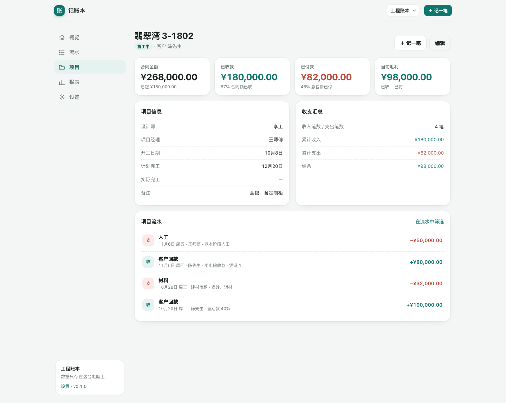

# 记账本

个人 / 工程两用的本地记账 Web App。一个 Go 二进制，内嵌页面，数据存在本机 SQLite 文件里；手机浏览器可「添加到主屏幕」当 App 用。

## 界面预览

| 概览 | 工程账本 · 项目详情 |
| --- | --- |
|  |  |

| 手机端 | 深色模式 |
| --- | --- |
|  |  |

## 快速开始

```bash
# 方式一：源码运行
go run ./cmd/book

# 方式二：用编译好的二进制（macOS arm64 示例）
./dist/accountbook-darwin-arm64
```

默认地址 <http://127.0.0.1:8787>，数据目录 `./data`：

```
data/
├── book.db        # SQLite 数据库
├── uploads/       # 凭证图片（按月分目录）
└── backups/       # 自动备份，保留最近 7 份
```

常用参数：

```bash
./accountbook -addr 0.0.0.0:8787   # 允许手机在同一 Wi-Fi 下访问
./accountbook -data ~/记账数据      # 自定义数据目录
./accountbook -open=false          # 不自动打开浏览器
```

端口被占用时会自动顺延到下一个可用端口。

## 手机使用

1. 电脑上以 `-addr 0.0.0.0:8787` 启动，日志会打印「手机同 Wi-Fi 访问」的局域网地址；
2. 手机浏览器打开该地址即可记账（界面已按手机适配）；
3. iPhone Safari「分享 → 添加到主屏幕」，Android Chrome「添加到主屏幕」，即可全屏运行。

注意：Service Worker 离线缓存只在 `localhost` 或 HTTPS 下生效；通过局域网 `http://` 访问时页面照常可用，只是不缓存离线资源。

## 功能

- **概览**：本月收入 / 支出 / 结余、待补凭证、支出构成环形图、项目毛利 Top 3、最近流水；
- **流水**：按月份浏览、收支 / 项目 / 分类筛选、关键词搜索、只看缺凭证的支出；按日分组显示当日收支小计；
- **记一笔**：方向、金额、日期、分类、归属项目、支付方式、往来对象、备注，可上传凭证截图（自动压缩到最长边 1600px 的 JPEG）；
- **项目**（工程账本）：合同额、总包价、客户 / 设计师 / 项目经理、开工与完工日期、已收 / 已付 / 毛利、项目流水；
- **报表**：近 6 个月收支趋势、支出构成、项目毛利排行、导出当月 CSV（带 BOM，Excel 直接打开）；
- **设置**：多账本切换与新建、分类管理、备份数据库、数据目录与记录数。

默认预置两个账本：**个人账本**（日常收支）和**工程账本**（按项目归集）。

## 数据约定

- 金额一律以「分」存储（`int64`），计算不经过浮点；输入支持 `1,280.50`、`¥1280`、`1280元`；
- 月度归属看流水日期 `occurred_on` 的年月，与录入时间无关；
- 删除为软删除（项目删除后其流水保留，不再归属项目）；
- 凭证图片只存本机 `data/uploads/`，数据库里只记文件名；
- 备份使用 `VACUUM INTO`，每天首次启动自动备份一次，也可在设置里手动备份。

## 目录结构

```
cmd/book/          程序入口（HTTP 服务、自动备份、打开浏览器）
cmd/genicon/       生成 PWA 图标（可选）
internal/store/    SQLite 读写：账本、分类、项目、流水、附件、统计
internal/web/      HTTP 路由、模板渲染、上传与图片压缩、CSV 导出
  assets/templates/  服务端模板（layout + 各页面）
  assets/static/     CSS、原生 JS、SVG 图表、manifest、service worker
scripts/build.sh   交叉编译 macOS / Linux / Windows
```

## Windows 发行包

```bash
VERSION=0.1.0 ./scripts/build.sh           # 交叉编译，产出 dist/记账本.exe
VERSION=0.1.0 ./scripts/package-windows.sh # 打包 dist/记账本-windows-x64.zip
```

压缩包结构：

```
记账本-windows-x64/
├── 记账本.exe
├── start-local.bat      # 仅本机
├── start-phone.bat      # 手机同 Wi-Fi 访问
├── 使用教程.md          # 详细图文教程
├── SHA256SUMS.txt
├── screenshots/
└── data/                # 首次启动生成
```

面向 Windows 用户的完整步骤（解压、SmartScreen、防火墙、手机访问、备份迁移、FAQ）见
[Windows 使用教程](docs/Windows使用教程.md)。

## 构建与测试

```bash
go test ./...                 # 路由、CRUD、上传、CSV、账本切换的集成测试
VERSION=0.1.0 ./scripts/build.sh
```

产物在 `dist/`：macOS（arm64 / amd64）、Linux amd64、Windows `记账本.exe`（约 14 MB）。

## 设计边界

这是「个人版」：单用户、无登录、无审批流。刻意没有实现原需求文档里的员工工资 / 业绩提成 / 季度分红 / 报销审批，那些依赖多角色与组织数据；如果以后要做团队版，建议在现有 `books / projects / transactions` 之上加 `members / approvals` 两组表，而不是改现有账目结构。

后续可选：

- 分账计算器（按合同额、总包价估算项目经理与公司分成）；
- 凭证 OCR / 金额自动识别；
- 年度报表与多账本汇总；
- 简单的登录 + 局域网内多人共用一个数据库。
