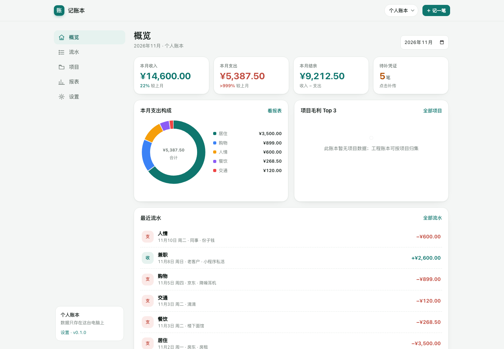

# 记账本 · Windows 使用教程

版本 0.1.0 ｜ 适用于 Windows 10 / 11（64 位）

---

## 一、这是什么

「记账本」是一个**只保存在本机**的个人 / 装修工程记账工具：

- 双击一个 `记账本.exe` 就能用，不需要安装 Go、数据库、也不依赖网络；
- 启动后会自动打开浏览器，界面就是一个本地网页；
- 所有数据（流水、项目、凭证图片、备份）都在 exe 旁边的 `data` 文件夹里；
- 手机连同一个 Wi-Fi 也能打开，像 App 一样添加到主屏幕。

它**没有账号、没有云同步**：数据只在你自己的电脑上，换电脑需要手动拷贝 `data` 文件夹。

---

## 二、压缩包里有什么

解压后目录大致如下：

```
记账本-windows-x64\
├── 记账本.exe              ← 主程序，双击启动
├── start-local.bat         ← 仅本机使用（默认模式）
├── start-phone.bat         ← 允许手机在同一 Wi-Fi 访问
├── 使用教程.md             ← 本文件
├── SHA256SUMS.txt          ← 文件校验值（可选核对）
├── screenshots\            ← 界面截图
│   ├── overview.png
│   ├── project.png
│   └── mobile.png
└── data\                   ← 第一次启动后自动生成
    ├── book.db
    ├── uploads\
    └── backups\
```

**解压位置建议**：`D:\记账本\` 这类普通目录。

**不建议**：

- `C:\Program Files\`（无写权限，数据会写不进去）；
- 微信 / QQ 的临时接收目录（可能被清理）；
- OneDrive、坚果云等同步盘（SQLite 数据库被同步进程占用容易损坏）。

---

## 三、第一次启动（3 步）

### 第 1 步：双击 `记账本.exe`

也可以双击 `start-local.bat`（效果一样，额外处理了控制台中文编码）。

### 第 2 步：处理 Windows 安全提示

因为程序没有购买代码签名证书，第一次运行可能出现：

> Windows 已保护你的电脑

点 **「更多信息」→「仍要运行」** 即可。只需要处理一次。

如果被杀毒软件拦截，把 `记账本.exe` 加入信任 / 白名单。程序不联网、不写系统目录，只读写自己旁边的 `data`。

### 第 3 步：浏览器自动打开

正常会看到黑色命令行窗口，并自动打开浏览器：

```
20:27:01 记账本 v0.1.0 已启动
20:27:01 本机访问: http://127.0.0.1:8787
20:27:01 数据目录: D:\记账本\data
```

浏览器地址栏是 `http://127.0.0.1:8787`。

如果浏览器没自动打开，手动复制上面的地址访问即可。

> ⚠️ **黑色窗口就是程序本体，不要关闭它。** 关闭窗口 = 退出记账本；重新使用要再次双击 exe。

---

## 四、界面速览



| 页面 | 用途 |
| --- | --- |
| **概览** | 本月收入 / 支出 / 结余、待补凭证、支出构成、项目毛利 Top 3、最近流水 |
| **流水** | 按月看账；按收支、项目、分类筛选；搜索备注；只看缺凭证的支出 |
| **记一笔** | 记录一笔收入或支出，可上传凭证截图 |
| **项目** | 工程账本专用：合同额、总包价、客户、设计师、项目经理、已收 / 已付 / 毛利 |
| **报表** | 近 6 个月趋势、支出构成、项目毛利排行、导出当月 CSV |
| **设置** | 切换 / 新建账本、管理分类、备份数据库、查看数据目录 |

默认预置两个账本：

- **个人账本**：工资、房租、餐饮、购物等日常收支；
- **工程账本**：按装修项目归集客户回款和材料、人工支出。

右上角下拉框可以随时切换账本。

---

## 五、日常记账流程

### 1. 记一笔

点右上角 **「＋ 记一笔」**（手机上点底部中间的 ＋）：

| 字段 | 说明 |
| --- | --- |
| 支出 / 收入 | 先选方向，分类会跟着切换 |
| 金额 | 支持 `1280`、`1,280.50`、`¥1280`、`1280元` |
| 日期 | 决定这笔账算在哪个月，可以补记以前的账 |
| 分类 | 个人账本有餐饮 / 交通 / 居住等；工程账本有材料 / 人工 / 客户回款等 |
| 归属项目 | 工程账本里才有意义，选「不归属项目」也可以 |
| 支付方式 | 微信 / 支付宝 / 银行卡 / 现金 / 其他，可不填 |
| 往来对象 | 客户、商家、材料商，可不填 |
| 备注 | 自由填写 |
| 凭证截图 | 拍照或选择图片，自动压缩后保存 |

点「保存」即可，列表会按日期倒序显示。

### 2. 上传凭证

- 支持 JPG / PNG / WebP / GIF，单张不超过 20MB；
- 程序会自动把长边压到 1600px、转成 JPEG，节省空间；
- 图片保存在 `data\uploads\年\月\` 下，数据库只记文件名；
- 编辑流水时，勾选缩略图下方的「删除」可以移除凭证。

### 3. 查账与筛选

「流水」页面：

- 顶部月份选择器切换月份；
- 「全部 / 收入 / 支出」切换方向；
- 按项目、分类筛选，或输入关键词搜索备注和往来对象；
- 概览里点「待补凭证」会直接筛出本月没有凭证的支出，补完就安心了。

### 4. 建立工程项目

1. 右上角切到 **工程账本**；
2. 进入「项目」→「＋ 新建项目」；
3. 填写项目名称、客户、设计师、项目经理、合同金额、总包价、开工 / 计划完工日期；
4. 保存后进入项目详情，点「＋ 记一笔」记的账会自动归属该项目；
5. 项目详情会实时算出：已收款、已付款、当前毛利（已收 − 已付）。

### 5. 报表与导出

「报表」页面：

- 近 6 个月收支趋势；
- 本月支出构成；
- 项目毛利排行；
- 右上角「导出本月 CSV」：Excel 可直接打开（带 BOM，不会中文乱码）。

### 6. 管理分类

「设置」→「分类」里可以新增支出 / 收入分类。默认分类够用的话不用管。

---

## 六、手机 / 平板访问（同一 Wi-Fi）

### 第 1 步：用「手机访问模式」启动

关闭正在运行的程序（关掉黑色窗口），双击 **`start-phone.bat`**。

它等价于命令行：

```bat
记账本.exe -addr 0.0.0.0:8787 -data data
```

### 第 2 步：看控制台里的局域网地址

窗口中会多出几行，例如：

```
手机同 Wi-Fi 访问: http://192.168.1.23:8787
提示：手机访问时请保持电脑不休眠，并在防火墙中允许该端口。
```

### 第 3 步：手机打开这个地址

- 手机必须和电脑连**同一个 Wi-Fi**（不能一个连路由器、一个连光猫的不同网段）；
- Windows 防火墙弹窗时，勾选「专用网络」并允许；如果没弹窗但手机打不开，去「Windows 安全中心 → 防火墙和网络保护 → 允许应用通过防火墙」里放行，或临时关闭防火墙测试；
- 打开后可以「添加到主屏幕」：
  - iPhone Safari：分享 → 添加到主屏幕；
  - Android Chrome：菜单 → 添加到主屏幕。

### 注意

- 通过 `http://192.168.x.x` 访问时，**离线缓存不生效**（浏览器限制 Service Worker 只在 localhost / HTTPS 下工作），但记账功能完全正常；
- 电脑休眠 / 关机后手机就打不开了；
- 路由器重启后电脑 IP 可能变化，以控制台打印的地址为准；
- **不要**把 8787 端口映射到公网：程序没有登录功能，谁能访问谁就能看账。

---

## 七、数据、备份与迁移

### 数据在哪

程序目录下的 `data\`：

```
data\
├── book.db          ← 全部账目（SQLite 单文件）
├── uploads\         ← 凭证图片
└── backups\         ← 数据库备份
```

想换位置：用 `-data "D:\我的账本"` 启动（见第八节）。

### 自动备份

- 每天第一次启动时自动备份一次；
- 备份文件形如 `book-20261103-202212.db`，保留最近 7 份；
- 也可以在「设置 → 数据与备份」里点「立即备份数据库」。

### 手动备份 / 迁移到新电脑

1. 关闭程序（关掉黑色窗口）；
2. 把整个 `data` 文件夹复制到 U 盘 / 移动硬盘；
3. 在新电脑解压程序，把 `data` 放到 exe 旁边，双击启动即可。

> 备份时建议先关闭程序，避免数据库正在写入。

### 从备份恢复

1. 关闭程序；
2. 进入 `data\backups\`，挑一个备份文件；
3. 把它复制到 `data\` 并改名为 `book.db`（覆盖前先把现有 `book.db` 改名为 `book.db.bak` 留底）；
4. 重新启动。

### 升级版本

1. 关闭程序；
2. 用新的 `记账本.exe` 覆盖旧的（`data` 不要动）；
3. 重新启动。数据库结构若有升级会自动处理。

---

## 八、命令行参数与高级用法

在程序目录打开「命令提示符」或 PowerShell：

```bat
记账本.exe -h
```

| 参数 | 默认值 | 说明 |
| --- | --- | --- |
| `-addr` | `127.0.0.1:8787` | 监听地址。仅本机用默认值；手机访问用 `0.0.0.0:8787` |
| `-data` | `data` | 数据目录，可以是相对或绝对路径 |
| `-open` | `true` | 启动后是否自动打开浏览器；服务器上可设 `-open=false` |

示例：

```bat
:: 换数据目录
记账本.exe -data "D:\记账数据"

:: 换端口（8787 被占用时会自动顺延，也可以手动指定）
记账本.exe -addr 127.0.0.1:9000

:: 手机访问 + 自定义数据目录
记账本.exe -addr 0.0.0.0:8787 -data "D:\记账数据"
```

### 开机自动启动（可选）

1. 按 `Win + R`，输入 `shell:startup`，回车；
2. 把 `start-phone.bat`（或 exe 的快捷方式）复制进去；
3. 下次登录 Windows 会自动启动。

### 端口被占用

程序会自动尝试 8788、8789……，以控制台打印的「本机访问」地址为准。

---

## 九、常见问题（FAQ）

**Q1：双击后窗口一闪而过 / 没反应？**
在程序目录按住 `Shift` 右键 →「在此处打开 PowerShell 窗口」，输入 `.\记账本.exe` 回车，看具体报错。常见原因是杀毒软件拦截、目录无写权限（如 Program Files）、或 exe 被杀软隔离。

**Q2：浏览器提示「无法访问此网站」？**
先确认黑色窗口还开着、地址是不是 `http://127.0.0.1:8787`；如果窗口里显示的是别的端口（端口被占用自动顺延），用窗口里那个地址。

**Q3：手机打不开？**
依次检查：是否用 `start-phone.bat` 启动（不是默认模式）；手机和电脑是否同一 Wi-Fi；Windows 防火墙是否放行；地址是否用了控制台打印的局域网 IP 而不是 127.0.0.1。

**Q4：控制台中文乱码？**
用 `start-local.bat` / `start-phone.bat` 启动（内部执行了 `chcp 65001`）；或手动在窗口里执行 `chcp 65001` 后再运行 exe。乱码只影响显示，不影响数据。

**Q5：数据存在哪？会不会上传到网上？**
只存在 `data\book.db` 和 `data\uploads\`。程序不包含任何联网上报逻辑，只有你主动访问的本地页面。

**Q6：误删了一笔怎么办？**
删除是软删除，界面不再显示，但可以通过「备份」恢复到删除前的状态（见第七节）。建议重要操作前先手动备份一次。

**Q7：能多台电脑同步吗？**
没有云同步。可以把 `data` 放在共享目录 / U 盘里轮换使用，但**不要两台电脑同时打开**同一个数据库文件，容易冲突。

**Q8：能在 Mac / Linux 上用吗？**
程序本身是跨平台编译的，构建脚本会同时产出 macOS（Apple 芯片 / Intel）和 Linux 版本；但这份 Windows 压缩包里只包含 Windows 版 exe。

**Q9：怎么彻底卸载？**
关闭程序，删除整个程序文件夹即可。没有注册表项、没有系统服务。如果设置了开机自启，删掉 `shell:startup` 里的快捷方式。

**Q10：界面能离线用吗？**
本机 `127.0.0.1` 属于安全上下文，首次打开后浏览器会缓存界面资源，断网也能继续记账；手机通过局域网 http 访问时不缓存，但功能正常。

---

## 十、安全边界

- 本程序是**单用户、无登录**设计。任何能访问到 `http://电脑IP:8787` 的人都能看到并修改账目；
- 仅建议在家庭 / 办公室可信网络中使用，**不要做公网端口映射**；
- 定期把 `data` 文件夹复制到移动硬盘或另一台电脑，是成本最低的防灾方式；
- 凭证图片可能包含客户信息，转存 / 分享前请留意隐私。

---

## 附：文件校验（可选）

`SHA256SUMS.txt` 里是 `记账本.exe` 的 SHA-256。Windows 上可在 PowerShell 中核对：

```powershell
Get-FileHash .\记账本.exe -Algorithm SHA256
```

两串字符一致，说明文件在下载 / 解压过程中没有损坏。
